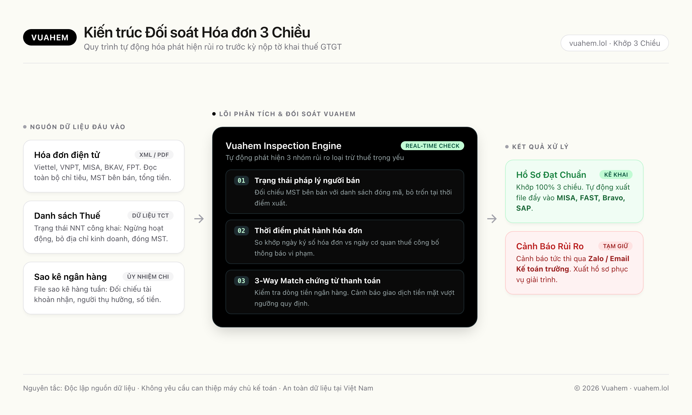
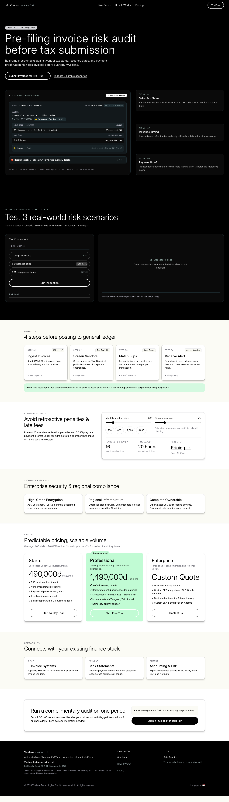

# Vuahem (vuahem.lol)

> Pre-filing input VAT and tax invoice risk audit platform.

Vuahem is an automated pre-filing invoice risk detection engine for Chief Accountants, CFOs, and business owners:
1. **Seller Tax Status Screening**: Real-time cross-referencing against statutory blacklists of suspended, closed, or relocated vendors.
2. **Issuance Timing Verification**: Flags invoices issued after official business suspension dates.
3. **3-Way Reconciliation**: Automated 3-way matching across XML/PDF Invoices ↔ Bank Statement Feeds (Payment Orders) ↔ Warehouse Receipts. Detects cash payments exceeding statutory thresholds.

---

## 3-Way Audit Engine Architecture



---

## Preview



---

## Bilingual content (EN / VI)

`index.html` ships one source file that renders either language. Default is English; `EN | TIẾNG VIỆT` switches in the utility bar and the mobile menu (choice remembered in `localStorage`, `Content-Security-Policy`-free, no framework).

Two kinds of bilingual content:

| Where | Mechanism | Where to edit |
|---|---|---|
| Static copy (headings, body, labels, FAQ…) | `<span class="i18n"><span lang="en">…</span><span lang="vi">…</span></span>` pairs, swapped by two CSS rules keyed off `<html lang>` | `i18n/pairs.json` |
| Script-rendered copy (scanner verdicts, scenario text, `hours` unit) | `{en, vi}` objects read through `tx()`; re-rendered on language change | the `<script>` block in `index.html` |

After editing English copy, re-run the builder — it re-wraps new strings and reports pairs that went stale, so the Vietnamese half cannot drift behind the English half unnoticed:

```bash
python3 tools/build_i18n.py            # rebuild (wraps i18n/pairs.json into index.html)
python3 tools/build_i18n.py --check    # rebuild-drift report (see make check for the gate)
make check                       # the gate: verify.py + check_design.py + check_lang.js + verify_i18n.js
node tools/check_lang.js               # runs the page <script> under a DOM shim; fails if VI render stays English
```

Style rules the Vietnamese copy follows: no em/en dashes in user-facing text; decimal points as `,`; monetary amounts `490.000 đ`; `Mã số thuế` → `MST` after first use; `xuất hóa đơn` (never `phát hành hóa đơn`); regulatory citations name the decree and article; brand, product and address names stay untranslated.

---

## Project Structure

Designed as a high-performance **single-file web application** with zero build dependencies:

- `index.html`: Complete landing page (Shopifi-inspired cinematic black & cream/mint design system, thin Grotesk display typography, and 100% pill-shaped controls).
- `i18n/pairs.json`: English → Vietnamese translation table (single source of truth for static copy).
- `tools/build_i18n.py`: wraps/re-checks bilingual pairs; `--check` is the drift gate.
- `tools/check_lang.js`: language-switch smoke test (DOM shim, no browser needed).
- `check_design.py`: Automated design system conformance gate (9 mechanical checks: pill button geometry, canvas discipline, font scale, ss03, touch target floors).
- `verify.py`: Content and legal integrity gate (17 checks: banned claims scan, anchor integrity, interactive demo sanity).
- `BUILD_LOG.md`: Comprehensive engineering log and self-critique rounds with Claude Opus & GPT-6.1-sol.
- `assets/`: Architecture diagram and page previews.

---

## Local Development

No Node.js or build tools required:

```bash
# Option 1: Open directly in browser
open index.html

# Option 2: Run via local HTTP server
python3 -m http.server 8000
# Visit: http://localhost:8000
```

---

## Automated Quality Gates

Run checks prior to deployment:

```bash
# Verify design system compliance
python3 check_design.py index.html

# Verify content, anchors & disclaimers
python3 verify.py index.html
```

---

## Legal & Entity

**Vuahem Technologies Pte. Ltd.**  
68 Circular Road, #02-01, Singapore 049422  

© 2026 Vuahem Technologies Pte. Ltd. (vuahem.lol). Technical demonstration environment. Automated risk signals do not replace official statutory tax filings or determinations.
